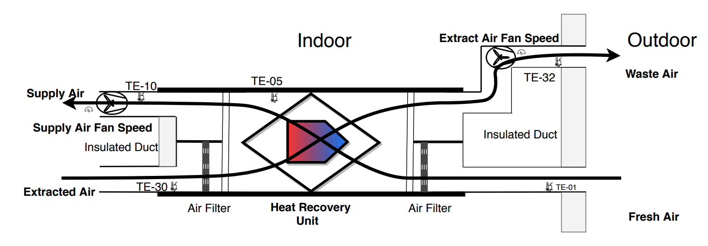

# Air Handling Unit (AHU) Documentation

---

## 1. Machine Description

A typical AHU with a balanced air ventilation system, as shown in *Fig. 1*, includes a Heat Recovery Unit (HRU), supply fan, extract fan, air filters, controllers, and sensors. The system circulates fresh air from outside into the building by utilising two fans (supply-side and extract-side) and two duct types (fresh air supply and exhaust vents).

Fresh air supply and exhaust vents can be installed in every room, but this system is typically designed to supply fresh air to bedrooms and living rooms — areas where occupants spend the majority of their time. A filter removes dust and pollen from outside air before it is pushed into the house. The system also extracts air from rooms where moisture and pollutants are most commonly generated (e.g., kitchen and bathroom).

One of the major components of the AHU is the HRU, which is used to reduce energy consumption. The principle behind the HRU is to extract heat from the outgoing air (before it is expelled as waste air) and utilise it to pre-heat fresh incoming air. The HRU is therefore a fundamental component of the AHU that enables heat recycling.

To measure the efficiency of the HRU, five temperature sensors are installed in the AHU, measuring the temperature of circulating air at different points in the system. In addition to sensor data, HRU control state, supply fan speed, and extract fan speed are also collected from the system. (M. Madhikermi et al.)

*Fig. 1 — AHU system overview with balanced ventilation* (M. Madhikermi et al.)

---

## 2. Dataset

### 2.1 Data Collection

Data was recorded using a set of sensors that capture temperature and humidity at various points in the AHU. The HRU has embedded sensors to capture the rotational speed of the unit, and fan speeds were also recorded via dedicated sensors.

### 2.2 Dataset Summary

| Property | Value |
|---|---|
| **Recording interval** | Every 5 minutes |
| **Start date** | 2013-05-05 |
| **End date** | 2026-03-31 |
| **Total records** | 1,226,115 |
| **Number of features** | 19 |

---

## 3. Features

### 3.1 Temporal

| Feature | Type | Description |
|---|---|---|
| `Time (UTC)` | `Datetime` | Timestamp of each recording, structured as `YYYY-MM-DD HH:MM`. Recordings are taken at 5-minute intervals. |

---

### 3.2 Temperature Sensors

| Feature | Unit | Sensor | Description |
|---|---|---|---|
| `HREG_T_OP2` | °C | — | General house (ambient) temperature. |
| `HREG_T_FRS` | °C | TE-01 | Temperature of fresh incoming air before it enters the system. |
| `HREG_T_SPLY_LTO` | °C | TE-05 | Temperature of incoming air *after* passing through the HRU. |
| `HREG_T_SPLY` | °C | TE-10 | Supply air temperature before passing through the supply fan. Note: may differ from the TE-05 reading. |
| `HREG_T_WST` | °C | TE-32 | Temperature of waste air *after* passing through the HRU and before it is expelled outside. |
| `HREG_T_EXT` | °C | TE-30 | Temperature of extracted air *before* it passes through the filter and HRU. |

---

### 3.3 Fan Speeds

| Feature | Description |
|---|---|
| `HREG_EFFECTIVE_TF` | Rotational speed of the supply (incoming) air fan, measured after sensor TE-10. |
| `HREG_EFFECTIVE_PF` | Rotational speed of the extract (outgoing) air fan, measured before sensor TE-32. |

---

### 3.4 Humidity

| Feature | Description |
|---|---|
| `HREG_HUM_EXT` | Humidity of the extracted (outgoing) air. |
| `HREG_AI1_RES` | Humidity of the supply (incoming) air. |
| `HREG_RH_MEAN` | Mean relative humidity measured over the preceding 48-hour window. |

---

### 3.5 Room Environment

| Feature | Room | Measurement |
|---|---|---|
| `HREG_AI3_RES` | Room 1 | Air temperature |
| `HREG_AI4_RES` | Room 2 | Air temperature |
| `HREG_AI5_RES` | Room 1 | CO₂ concentration |
| `HREG_AI6_RES` | Room 2 | CO₂ concentration |

---

### 3.6 HRU Performance

| Feature | Description |
|---|---|
| `HREG_LTO_N_SPLY` | Heat Recovery Efficiency — Supply side. *Function waiting on Kary* |
| `HREG_LTO_N_EXT` | Heat Recovery Efficiency — Extract side. *Function waiting on Kary* |
| `HREG_OUTPUT` | Rotational speed of the HRU. A value of `0` indicates the HRU is stationary (not recovering heat); non-zero values indicate the current rotation speed. |
